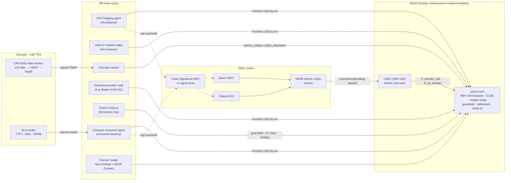
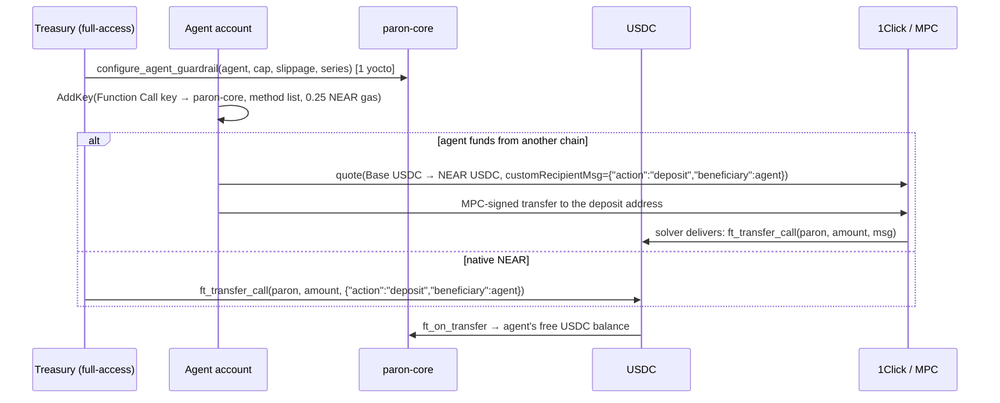
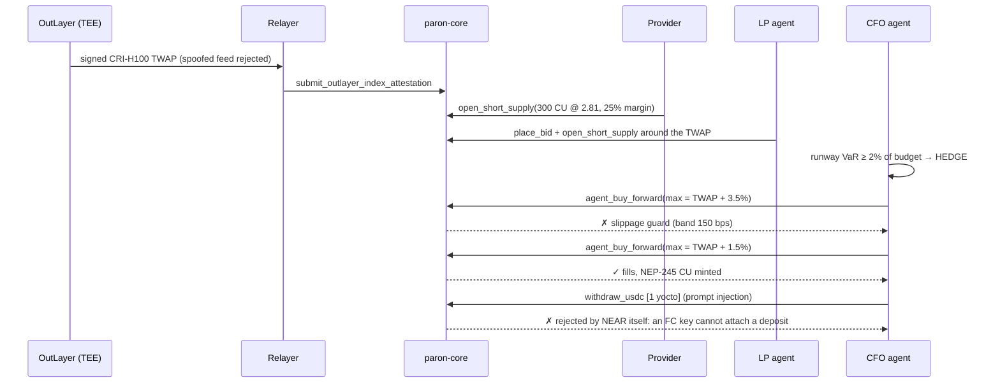
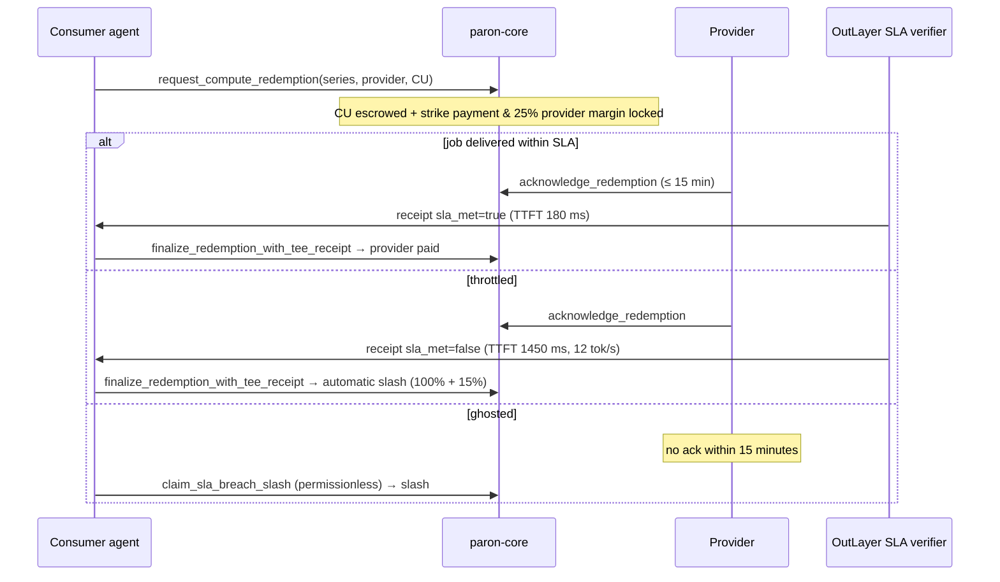

# Paron v2: features and flows

This page shows the whole system on one page: who the actors are, what each component does, and how value and
information move between them. The diagrams render on GitHub (Mermaid).

## 1. System map



## 2. Feature inventory

### Smart contract: `contracts/paron-core` (Rust, near-sdk 5.30, 39 tests)

| Area | Features | Main methods |
| --- | --- | --- |
| Canonical unit | 1 CU = 1 h H100 SXM 80GB; hardware weights A100 0.45× · H100 1.00× · H200 1.40× · B200 2.50× · GB200 3.50× | `convert_hardware_to_cu` |
| NEP-245 forwards | 3 maturities (`CU-2026-11`, `CU-2026-12`, `CU-2027-01`); balances, supply, transfers (transfers need a full-access key) | `mt_balance_of`, `mt_transfer(_call)`, `mt_batch_*`, `mt_token` |
| USDC ledger | deposits via `ft_transfer_call` (`deposit` to self or beneficiary, `insurance`, `fund_genesis`); withdrawal needs 1 yocto, so a full-access key | `ft_on_transfer`, `withdraw_usdc`, `usdc_balance_of` |
| Genesis liquidity | the book has depth from block one; all withdrawals stay locked until the credit is repaid in real USDC | `protocol_stats` |
| Order book (CLOB) | price-time priority, fully escrowed bids, margin-backed asks, self-cross guard | `agent_buy_forward`, `place_bid`, `sell_forward`, `cancel_order`, `get_order_book` |
| Margin vaults | short supply with 25% initial / 15% maintenance margin; top-up, excess withdrawal, health, liquidation price | `open_short_supply`, `top_up_margin`, `withdraw_excess_margin`, `check_vault_health` |
| Liquidation | permissionless; the liquidator takes over the obligation at the attested mark with fresh 25% margin, earns a 2.5% bonus, and the insurance pool covers bad debt | `liquidate_underwater_vault`, `get_liquidation_receipts` |
| Stale-quote protection | every attestation purges orders more than 5% through the new index | (inside attestation) |
| Agent guardrails | daily spend cap with UTC reset, slippage band around the attested TWAP, series allowlist, pause switch, owner delegation | `configure_agent_guardrail`, `set_agent_paused`, `delegate_guardrail_owner`, `agent_remaining_allowance` |
| OutLayer oracle | Ed25519 verification of TEE attestations, ≤ 1 h freshness, monotonic timestamps, replay set, 100% circuit breaker | `submit_outlayer_index_attestation`, `set_tee_signer_pubkey` |
| Mode A | cash settlement at maturity only, against a post-maturity attestation: payout Q × P_index | `finalize_series_settlement`, `settle_cash_hedge` |
| Mode B | redeem CU for real compute; the TEE receipt pays the provider, or a breach slashes them (100% refund + 15%); a ghosted provider is slashed after the deadline | `request_compute_redemption`, `acknowledge_redemption`, `finalize_redemption_with_tee_receipt`, `claim_sla_breach_slash` |
| Audit | conservation invariants (circulating CU = Σ obligations), protocol statistics, receipts | `audit_series_invariants`, `protocol_stats`, `get_redemptions` |

### Testnet token: `contracts/test-usdc` (NEP-141, 3 tests)

A test USDC with 6 decimals and no value. It has `mint` for the owner and a public `faucet` (up to 100,000 tUSDC per call).

### TEE worker: `tee-worker/outlayer-cri-oracle` (Rust → wasm32-wasip2, 10 tests)

* **CRI-H100 index.** Normalises multi-tier feeds to H100-equivalent prices, rejects outliers at ±2σ (median/MAD) per
  bucket, and computes a volume-weighted VWAP per bucket and a TWAP across buckets.
* **Commitment.** `tdx_quote_hash = sha256(measurement ‖ payload)`, signed with Ed25519 using a key derived through
  OutLayer `signing_keys`.
* **SLA verifier.** Measures TTFT, throughput and VRAM against the policy and returns a signed `sla_met` verdict plus violations.
* **CLI.** `--mode demo|pubkey|vectors|stdin`. Golden vectors in `shared/golden-vectors.json` keep it byte-identical
  with the TypeScript mirror.

### Agents and SDK: `agents/` (TypeScript, 19 tests)

| Component | What it does |
| --- | --- |
| CFO hedging agent | computes runway VaR (volatility × horizon) against the budget; when the VaR exceeds 2%, hedges inside its guardrail and re-plans after a rejection; settles at maturity |
| Yield-LP market maker | two-sided post-only quotes around the TWAP; risk loop that tops margin up to a 40% buffer; keeper that liquidates other vaults; re-centres after every attestation; unwinds |
| Compute consumer agent | buys inventory, opens Mode B jobs, submits TEE receipts, slashes ghosted providers |
| Compute provider node | pre-sells capacity with 25% margin; acknowledges jobs |
| NEAR Intents 1Click client | `/v0/quote`, `/v0/deposit/submit`, `/v0/status`; routes `customRecipientMsg` into `ft_on_transfer` (live dry quote verified) |
| Chain Signatures | derives Base/EVM and Solana addresses from a NEAR account, plus ERC-20 and SOL transfer payloads and MPC sign requests (parity with `chainsig.js`) |
| Local engine | `ParonLocalContract` (a mirror of the Rust contract, parity-tested) and `LocalNearRuntime` (Ed25519-signed txs, Function Call key rules, rollback) for zero-config mode |
| Live client | `NearLiveClient` (near-api-js 7): calls with tx hashes, readable error messages |
| Swarm | 5 acts, 58 signed txs, a deterministic receipt (`receipt_sha256`) and an independent verifier (`verify:receipt`) |
| Testnet ops | `testnet:deploy` (faucet accounts → deploy → funding → guardrails → FC keys) and `testnet:scenario` (supply, hedge, spike, modeb, ghost, drill, settle, status) |

### Web: `web/` (Next.js 15)

| Page / API | Contents |
| --- | --- |
| `/` Terminal | protocol strip; Series Matrix + forward curve + hardware→CU calculator; Order Book Desk (buy/short, margin slider, guardrail check, sign on testnet); **Live on NEAR testnet** (live RPC data + run timeline with nearblocks links, test-USDC faucet); Agent Swarm (activity stream, Function Call key delegation from a wallet); OutLayer TEE Attestation (attest a custom index, spoofed feed); Settlement & Redemption (Mode A at a chosen TWAP, Mode B happy/throttled/ghost jobs) |
| `/tour` | 60-second coded tour of the 5 acts (autoplay/step), downloadable receipt with the same hash as the CLI |
| `GET /api/state?acts=N` | protocol snapshot after N acts |
| `GET /api/receipt` | deterministic audit receipt |
| `POST /api/oracle/attest` | attestation from the worker mirror |
| `POST /api/intents/quote` | 1Click quote (live when `ONE_CLICK_JWT` is set) |
| `GET /api/testnet` | state of the deployed contract on testnet + the public run log |
| Wallet | `@hot-labs/near-connect`: faucet, USDC deposit, `place_bid`, `open_short_supply`, `AddKey` delegation |

### Quality and delivery

* `npm run verify:all` runs 4 gates (Rust contracts, TEE worker, agent swarm, web build) with zero configuration.
* GitHub Actions `ci-cd`: the 4 gates on every push and PR, then a Vercel deploy (production from `main`, a preview per
  PR) once the `VERCEL_*` secrets are set.
* `deployments/*.json`: the public record of the testnet deployment and of the live run.

## 3. Main flows

### 3.1 Onboarding & funding



### 3.2 Supply, hedging and guardrails



### 3.3 Price spike, liquidation, Mode A

```mermaid
sequenceDiagram
  participant R as Relayer
  participant P as paron-core
  participant MM as LP agent (keeper)
  participant C as CFO agent
  R->>P: attestation 2.80 → 3.05 → 3.35 → 3.70 → 4.10
  P->>P: purge quotes >5% off the index; flag vaults < 15%
  MM->>P: top_up_margin (own vault back to 40%)
  MM->>P: liquidate_underwater_vault(provider vault)
  P-->>MM: takes over the obligation at the mark + 25% margin + 2.5% bonus
  Note over P: after maturity (2026-11-30 23:59:59Z)
  R->>P: post-maturity attestation + finalize_series_settlement
  C->>P: settle_cash_hedge → receives Q × P_index ($2,050 vs $1,404 cost)
```

### 3.4 Mode B: redemption as compute



### 3.5 Judge flow (no wallet)

1. `npm run verify:all`: 4 gates.
2. `npm run dev` → `/tour` → *Run*: 5 acts, then download the receipt and run `npm run verify:receipt`.
3. `/`: try the Order Book Desk (set a price above the guardrail to watch it get rejected), then the TEE card (spoofed
   feed) and Mode B jobs.
4. *Live on NEAR testnet* panel / README: the nearblocks links prove it on a real network.
